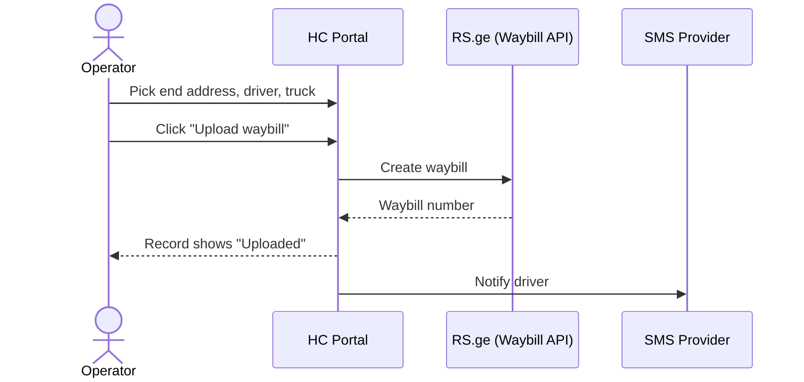
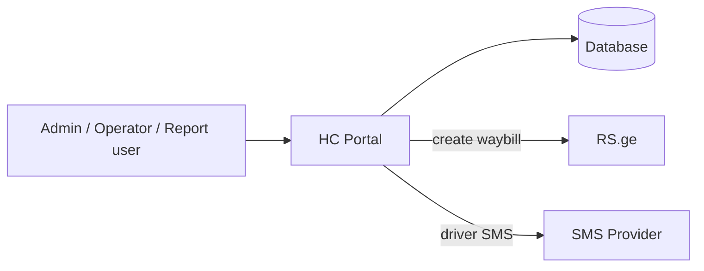

# HC — Carrier & Waybill Portal

A web app where **carrier operators** prepare truck shipments, upload the **waybill to RS.ge** and notify the **driver by SMS**.

## How it works



## System overview



## Reference data

| Entity | Fields |
|---|---|
| **Carrier** | Name, code, start address (one), end addresses (one or more) |
| **Driver** | First/last name, personal ID, phone |
| **Truck** | Model, plate number, trailer number |
| **User** | Name, phone, email, role |

**Roles:** `Admin` · `Operator` (bound to one carrier) · `Report user`

## Running the app

The app is a React + TypeScript front end (Vite, Tailwind) plus a small Node API server (`server/`, no dependencies). The front end runs in the browser and is wrapped as a native Android app with [Capacitor](https://capacitorjs.com). Browsers and the Android app all talk to the same server, which owns the data, enforces roles and runs the RS.ge → SMS pipeline.

> **SMS is mocked** (`server/integrations.ts`) and always succeeds. **RS.ge** is called for real (`server/rsge.ts`) with the service user the admin enters. There is no simulator. Data is stored by the server in SQLite at `server/data/hc.db` (Node's built-in `node:sqlite`; override with `HC_DB_FILE`). Delete `hc.db*` to start over with only the admin. On first start an existing `server/data/db.json` (the old storage) is imported and renamed to `db.json.imported`. Back up `hc.db` with `sqlite3 hc.db ".backup copy.db"` (a plain file copy while the server runs can miss the newest changes in `hc.db-wal`).

> **Secrets:** the server reads `.env` in the project root. On first start it generates `HC_SECRET_KEY` there, which encrypts the RS.ge password in `hc.db`. Keep `.env` out of database backups (a copied `hc.db` is useless without it) but don't lose it: with a different key the RS.ge password can't be read and has to be entered again. A password stored by an older version is encrypted on the next start.

> **Sessions** end after 30 days without use or 90 days after login. A user is logged out everywhere when their phone number or role changes, or when they're deleted. **Times** are always shown and grouped by day in Georgian time (UTC+4), whatever the device's time zone.

### Dependencies

| For | You need |
|---|---|
| Web | **Node.js 22+** and npm |
| Android APK | Everything above, plus **JDK 21** and the **Android SDK** (platform API 36 + build-tools). Easiest way to get the SDK is installing Android Studio once, or the command-line tools only. The build script finds the SDK in Android Studio's default location and saves it to `android/local.properties`. If you installed it somewhere else, set `ANDROID_HOME`. `java` must be on `PATH` (or `JAVA_HOME` set). Missing SDK platform versions are downloaded automatically on the first build. |

Then install the packages once:

```bash
npm install
```

### Web

```bash
npm run dev          # http://localhost:5173 (also printed with your LAN IP, so you can open it on a phone)
                     # also starts the API server on port 8787 (restarts on changes); /api is proxied to it
npm run build        # production build → dist/
npm run server       # API server on port 8787 (PORT / HOST to change); also serves dist/ if built
```

### Android (APK)

```bash
npm run android:apk
```

This builds the web app, copies it into the Android project and builds the APK with Gradle. The app calls the API server at the address baked in at build time: by default this machine's LAN address on port 8787 (e.g. `http://192.168.1.10:8787`). Set `VITE_API_URL` to point it elsewhere, e.g. `VITE_API_URL=https://hc.example.ge npm run android:apk`. The phone must be able to reach that address, and the server (`npm run dev` or `npm run server`) must be running. The file is written to `release/hc-portal-v<version>.apk`. Send it to the user; they open it on the phone and allow "install from unknown sources" when asked.

The latest build is also saved as `release/hc-portal.apk` and copied into `dist/`, so the website serves it at `/hc-portal.apk`. Phones and tablets opening the site in a browser (not the installed app) see a **ჩამოტვირთე აპლიკაცია** (download the app) button on the login screen and in the account menu. The button only appears when that file exists. If your web server doesn't recognise `.apk`, set its content type to `application/vnd.android.package-archive`.

- **No signing setup is needed.** Gradle signs the APK with the debug key that the Android SDK creates on your machine (`~/.android/debug.keystore`).
- **Updates:** build from the same machine, or copy that `debug.keystore` file to the other machine. An APK signed with a different key won't install over the existing app; the user would have to uninstall first and would lose the app's local data.
- **Version:** comes from `version` in `package.json` (`1.2.3` becomes versionCode `10203`). Bump it for each build you send. Android won't install an update whose versionCode is lower than the installed one.

### Trying the flow

The interface is in Georgian.

1. Log in with a phone number. The only built-in user is the admin, **575780323**; there's no SMS code yet, so a known number logs in immediately. There must always be at least one admin: the last one can't be deleted or given another role, but an admin can delete their own account once another admin exists. As admin, add carriers, drivers, trucks and other users (each with their own phone number) in **ცნობარები**. Roles: **ოპერატორი** (operator) creates shipments, **ადმინისტრატორი** (admin) also manages reference data, **რეპორტ მომხმარებელი** (report user) is read-only.
2. As an operator, open **ახალი რეისი** (new shipment), pick the end address, driver and truck, then press **ზედნადების ატვირთვა** (upload waybill). The shipment page shows each step live: RS.ge → SMS.
3. In **API მოთხოვნები**: watch every RS.ge and SMS request and response (admins can clear the log).

### RS.ge waybills

Protocol: [`docs/rs-ge/waybill_protocol.pdf`](docs/rs-ge/waybill_protocol.pdf) (official, v4.0.4, from eservices.rs.ge → სერვისების დოკუმენტაცია). SOAP endpoint `https://services.rs.ge/WayBillService/WayBillService.asmx` (override with `RS_WAYBILL_URL`).

RS.ge has no separate sandbox host: everything goes to the normal endpoint, and waybills belong to whoever owns the service user. The test users in the protocol (`tbilisi` / `satesto2`, password `123456`) are rejected as of Nov 2026, so use a service user from RS.ge (for testing, cancel each waybill right after with **გაუქმება**).

Setup (admin, **ცნობარები → RS.ge**):

1. Create a **service user** on eservices.rs.ge (register the server's public IP for it) and enter its user name (`su`) and password (`sp`). The password is stored only on the server, encrypted (AES-256-GCM) with `HC_SECRET_KEY`, and never sent to browsers.
2. Press **კავშირის შემოწმება** (check connection). Typed-but-unsaved values are only tested; for the saved user this fills in the seller and loads RS.ge's units and transport types (it also happens on the first upload).
3. Fill in the buyer (tax ID, name; **მოძებნა** looks the name up on RS.ge), unit, price, VAT type and transport fields. They apply to every shipment.

Per shipment the server calls `save_waybill` (type 2, delivery with transport; returns the waybill ID, which is stored so a retry reuses it) and then `send_waybill` (activates it and returns the waybill number). On the shipment page, **დასრულება** calls `close_waybill` and **გაუქმება** calls `ref_waybill`. Every call appears in **API მოთხოვნები** with the password masked.

Duplicate protection: every waybill's `COMMENT` ends with the shipment's tag (`HC:<shipment id>`). The time of each `save_waybill` call is recorded before it is sent. If its answer never arrives (timeout, dropped connection, server restart), the next attempt first searches RS.ge (`get_waybills_v1`, by last-update time) for a waybill with that tag and continues with it instead of saving a second one. If that search fails, the retry stops with an error instead of risking a duplicate.

Mapping notes:
- RS.ge has no trailer field: the trailer number is written into `COMMENT`.
- Plate numbers are sent without dashes (`AA-123-BB` → `AA123BB`).
- Quantity is in tonnes; pick a tonne unit, or "other" (99) with the name ტონა (the default).
- Drivers have a citizenship (Georgian / foreign) → `CHEK_DRIVER_TIN`; foreigners can have a non-11-digit ID.
- `TRANSPORTER_TIN` is sent only when filled in. RS.ge then expects the transport company to activate the waybill, so leave it empty unless that's how you work.

### Mock assumptions to confirm with the client

- Cargo (description, code) and the declared quantity are set once by the admin and sent in the RS.ge `goods_list`.
- Drivers and trucks are shared across carriers. Only start/end addresses and operators are tied to a carrier.
