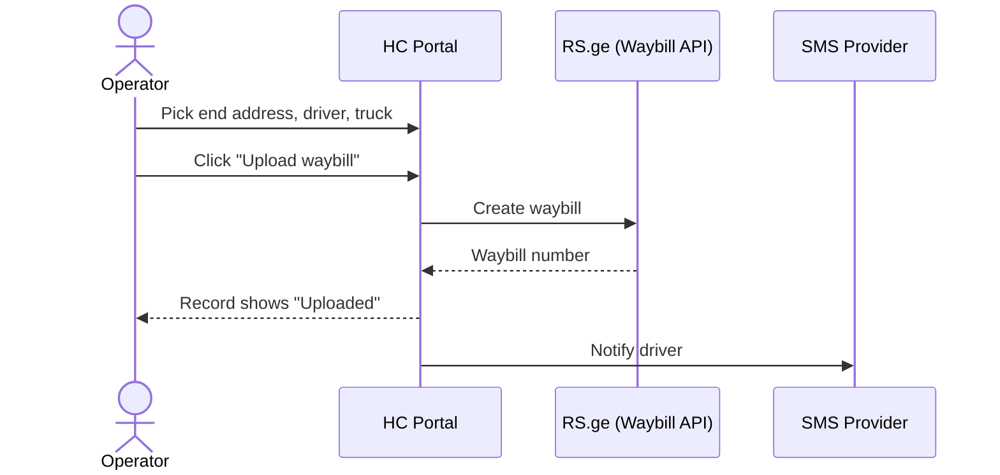
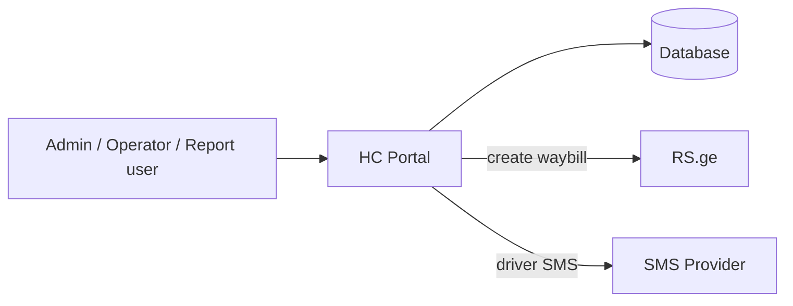

# HC — Carrier & Waybill Portal

A web app where **carrier operators** prepare truck shipments, upload the **waybill to RS.ge** and notify the **driver by SMS**.

## How it works



## System overview



## Reference data

| Entity | Fields |
|---|---|
| **Carrier** | Name, code, start address (one), end addresses (one or more) |
| **Driver** | First/last name, personal ID, phone |
| **Truck** | Model, plate number, trailer number |
| **User** | Name, phone, email, role |

**Roles:** `Admin` · `Operator` (bound to one carrier) · `Report user`

## Running the app

The app is a React + TypeScript front end (Vite, Tailwind) plus a small Node API server (`server/`, no dependencies). The front end runs in the browser and is wrapped as a native Android app with [Capacitor](https://capacitorjs.com). Browsers and the Android app all talk to the same server, which owns the data, enforces roles and runs the RS.ge → SMS pipeline.

> **RS.ge and SMS are mocked** (`server/integrations.ts`). Data is stored by the server in `server/data/db.json` (override with `HC_DB_FILE`). Delete that file to start over with only the admin.

### Dependencies

| For | You need |
|---|---|
| Web | **Node.js 22+** and npm |
| Android APK | Everything above, plus **JDK 21** and the **Android SDK** (platform API 36 + build-tools). Easiest way to get the SDK is installing Android Studio once, or the command-line tools only. The build script finds the SDK in Android Studio's default location and saves it to `android/local.properties`. If you installed it somewhere else, set `ANDROID_HOME`. `java` must be on `PATH` (or `JAVA_HOME` set). Missing SDK platform versions are downloaded automatically on the first build. |

Then install the packages once:

```bash
npm install
```

### Web

```bash
npm run dev          # http://localhost:5173 (also printed with your LAN IP, so you can open it on a phone)
                     # also starts the API server on port 8787 (restarts on changes); /api is proxied to it
npm run build        # production build → dist/
npm run server       # API server on port 8787 (PORT / HOST to change); also serves dist/ if built
```

### Android (APK)

```bash
npm run android:apk
```

This builds the web app, copies it into the Android project and builds the APK with Gradle. The app calls the API server at the address baked in at build time: by default this machine's LAN address on port 8787 (e.g. `http://192.168.1.10:8787`). Set `VITE_API_URL` to point it elsewhere, e.g. `VITE_API_URL=https://hc.example.ge npm run android:apk`. The phone must be able to reach that address, and the server (`npm run dev` or `npm run server`) must be running. The file is written to `release/hc-portal-v<version>.apk`. Send it to the user; they open it on the phone and allow "install from unknown sources" when asked.

The latest build is also saved as `release/hc-portal.apk` and copied into `dist/`, so the website serves it at `/hc-portal.apk`. Phones and tablets opening the site in a browser (not the installed app) see a **ჩამოტვირთე აპლიკაცია** (download the app) button on the login screen and in the account menu. The button only appears when that file exists. If your web server doesn't recognise `.apk`, set its content type to `application/vnd.android.package-archive`.

- **No signing setup is needed.** Gradle signs the APK with the debug key that the Android SDK creates on your machine (`~/.android/debug.keystore`).
- **Updates:** build from the same machine, or copy that `debug.keystore` file to the other machine. An APK signed with a different key won't install over the existing app; the user would have to uninstall first and would lose the app's local data.
- **Version:** comes from `version` in `package.json` (`1.2.3` becomes versionCode `10203`). Bump it for each build you send. Android won't install an update whose versionCode is lower than the installed one.

### Trying the flow

The interface is in Georgian.

1. Log in with a phone number. The only built-in user is the admin, **575780323**; there's no SMS code yet, so a known number logs in immediately. As admin, add carriers, drivers, trucks and other users (each with their own phone number) in **ცნობარები**. Roles: **ოპერატორი** (operator) creates shipments, **ადმინისტრატორი** (admin) also manages reference data, **რეპორტ მომხმარებელი** (report user) is read-only.
2. As an operator, open **ახალი რეისი** (new shipment), pick the end address, driver and truck, then press **ზედნადების ატვირთვა** (upload waybill). The shipment page shows each step live: RS.ge → SMS.
3. In **სატესტო პანელი** (mock console): watch every request and response, change latency, force RS.ge or SMS failures (to test retries), and reset the demo data.

### Mock assumptions to confirm with the client

- Cargo (description, code) and the declared quantity are set once by the admin and sent in the RS.ge `goods_list`.
- Drivers and trucks are shared across carriers. Only start/end addresses and operators are tied to a carrier.
