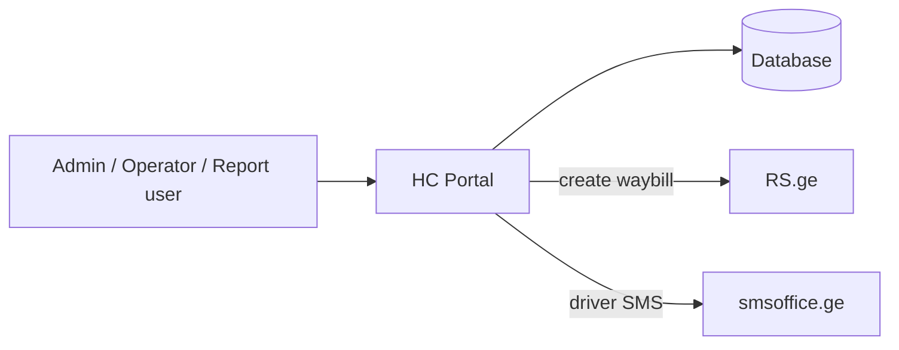

# HC — Carrier & Waybill Portal

A web app where **carrier operators** prepare truck shipments, upload the **waybill to RS.ge** and notify the **driver by SMS**.

## How it works

```mermaid
sequenceDiagram
    actor Op as Operator
    participant App as HC Portal
    participant RS as RS.ge (Waybill API)
    participant SMS as smsoffice.ge

    Op->>App: Pick carrier, route, driver, truck; type each product's quantity
    Op->>App: Click "Upload waybill"
    App->>RS: Create waybill
    RS-->>App: Waybill number
    App-->>Op: Record shows "Uploaded"
    App->>SMS: Notify driver
```

## System overview



## Reference data

| Entity | Fields |
|---|---|
| **Carrier** | Name, start address (one), end addresses (one or more, each with its scale ID) |
| **Route** | Carrier, end address, scale ID and its goods lines (start → end). Each line's bar code, name and unit are typed in, or filled from the product list with the search button and then still editable (nothing is added to RS.ge's list), with its unit price, VAT type and, for excise goods, the excise code (RS.ge's list, loaded on connect). Operators pick a route for each shipment and type each line's quantity (plus the optional additional quantity, QUANTITY_EXT), removing lines the truck doesn't carry; each line becomes one goods line on the RS.ge waybill |
| **Driver** | First/last name, personal ID, phone |
| **Truck** | Model, plate number, trailer number |
| **Product** | Name, bar code, unit and excise code, kept in step with the taxpayer's product list on RS.ge (see below); plus unit price and VAT type, kept only here. Searching a product on a route's goods line fills all of these in (still editable there) |
| **User** | Name, phone, email, role |

**Roles:** `Admin` · `Operator` (given one or more carriers) · `Report user`

## Running the app

The app is a React + TypeScript front end (Vite, Tailwind) plus a small Node API server (`server/`, no dependencies). The front end runs in the browser and is wrapped as a native Android app with [Capacitor](https://capacitorjs.com). Browsers and the Android app all talk to the same server, which owns the data, enforces roles and runs the RS.ge → SMS pipeline.

> **RS.ge** (`server/rsge.ts`) and **SMS** (`server/smsoffice.ts`, through [smsoffice.ge](https://smsoffice.ge)) are called for real with the accounts the admin enters. There is no simulator. Data is stored by the server in SQLite at `server/data/hc.db` (Node's built-in `node:sqlite`; override with `HC_DB_FILE`). Delete `hc.db*` to start over with only the admin. On first start an existing `server/data/db.json` (the old storage) is imported and renamed to `db.json.imported`. Back up `hc.db` with `sqlite3 hc.db ".backup copy.db"` (a plain file copy while the server runs can miss the newest changes in `hc.db-wal`).

> **Secrets:** the server reads `.env` in the project root. On first start it generates `HC_SECRET_KEY` there, which encrypts the RS.ge password and the SMS API key in `hc.db`. Keep `.env` out of database backups (a copied `hc.db` is useless without it) but don't lose it: with a different key the RS.ge password and SMS key can't be read and have to be entered again. A password stored by an older version is encrypted on the next start.

> **Sessions** end after 30 days without use or 90 days after login. A user is logged out everywhere when their phone number or role changes, or when they're deleted. **Times** are always shown and grouped by day in Georgian time (UTC+4), whatever the device's time zone.

### Dependencies

| For | You need |
|---|---|
| Web | **Node.js 22+** and npm |
| Android APK | Everything above, plus **JDK 21** and the **Android SDK** (platform API 36 + build-tools). Easiest way to get the SDK is installing Android Studio once, or the command-line tools only. The build script finds the SDK in Android Studio's default location and saves it to `android/local.properties`. If you installed it somewhere else, set `ANDROID_HOME`. `java` must be on `PATH` (or `JAVA_HOME` set). Missing SDK platform versions are downloaded automatically on the first build. |

Then install the packages once:

```bash
npm install
```

### Web

```bash
npm run dev          # http://localhost:5173 (also printed with your LAN IP, so you can open it on a phone)
                     # also starts the API server on port 8787 (restarts on changes); /api is proxied to it
npm run build        # production build → dist/
npm run server       # API server on port 8787 (PORT / HOST to change); also serves dist/ if built
```

### Android (APK)

```bash
npm run android:apk
```

This builds the web app, copies it into the Android project and builds the APK with Gradle. The app calls the API server at the address baked in at build time: by default this machine's LAN address on port 8787 (e.g. `http://192.168.1.10:8787`). Set `VITE_API_URL` to point it elsewhere, e.g. `VITE_API_URL=https://hc.example.ge npm run android:apk`. The phone must be able to reach that address, and the server (`npm run dev` or `npm run server`) must be running. The file is written to `release/hc-portal-v<version>.apk`. Send it to the user; they open it on the phone and allow "install from unknown sources" when asked.

The latest build is also saved as `release/hc-portal.apk` and copied into `dist/`, so the website serves it at `/hc-portal.apk`. Phones and tablets opening the site in a browser (not the installed app) see a **ჩამოტვირთე აპლიკაცია** (download the app) button on the login screen and in the account menu. The button only appears when that file exists. If your web server doesn't recognise `.apk`, set its content type to `application/vnd.android.package-archive`.

- **No signing setup is needed.** Gradle signs the APK with the debug key that the Android SDK creates on your machine (`~/.android/debug.keystore`).
- **Updates:** build from the same machine, or copy that `debug.keystore` file to the other machine. An APK signed with a different key won't install over the existing app; the user would have to uninstall first and would lose the app's local data.
- **Version:** comes from `version` in `package.json` (`1.2.3` becomes versionCode `10203`). Bump it for each build you send. Android won't install an update whose versionCode is lower than the installed one.

### Trying the flow

The interface is in Georgian.

1. Log in with a phone number. The only built-in user is the admin, **575780323**; there's no SMS code yet, so a known number logs in immediately. There must always be at least one admin: the last one can't be deleted or given another role, but an admin can delete their own account once another admin exists. As admin, add carriers, then open routes for them in **მარშრუტები** (pick the carrier, type the end address and its scale ID, and pick the product; the start address comes from the carrier), and add drivers, trucks, products and other users (each with their own phone number) in **ცნობარები**. Products need RS.ge to be connected first. An operator is given one or more carriers and sees those carriers' shipments. Roles: **ოპერატორი** (operator) creates shipments, **ადმინისტრატორი** (admin) also manages reference data, **რეპორტ მომხმარებელი** (report user) is read-only.
2. As an operator, open **ახალი რეისი** (new shipment), pick the carrier (skipped when there is only one), one of its routes (each shows its product), the driver and truck, then press **ზედნადების ატვირთვა** (upload waybill). The shipment page shows each step live: RS.ge → SMS.
3. In **API მოთხოვნები**: watch every RS.ge and SMS request and response (admins can clear the log).

SMS needs an smsoffice.ge account (see below). Without one, the SMS step fails with a message saying so; once it's set up, **ხელახლა გაგზავნა** on the shipment sends it.

### RS.ge waybills

Protocol: [`docs/rs-ge/waybill_protocol.pdf`](docs/rs-ge/waybill_protocol.pdf) (official, v4.0.4, from eservices.rs.ge → სერვისების დოკუმენტაცია). SOAP endpoint `https://services.rs.ge/WayBillService/WayBillService.asmx` (override with `RS_WAYBILL_URL`).

RS.ge has no separate sandbox host: everything goes to the normal endpoint, and waybills belong to whoever owns the service user. The test users in the protocol (`tbilisi` / `satesto2`) are rejected as of Nov 2026; the public test service user `YVELAM GAMOIYENET:12345678910` / `123456` works (test taxpayer 12345678910, driver `11111111111`). Anyone can see and change its waybills, so cancel each one right after with **გაუქმება**.

Setup (admin, **RS.ge** tab):

1. Create a **service user** on eservices.rs.ge (register the server's public IP for it) and enter its user name (`su`) and password (`sp`). The password is stored only on the server, encrypted (AES-256-GCM) with `HC_SECRET_KEY`, and never sent to browsers.
2. Press **კავშირის შემოწმება** (check connection). Typed-but-unsaved values are only tested; for the saved user this fills in the seller and loads RS.ge's units and transport types (it also happens on the first upload).
3. Fill in the transport fields. They apply to every shipment. The quantity here is optional: it is only prefilled on each product of a new shipment. Products, their price and VAT type are set per route in **ცნობარები → მარშრუტები**; the RS.ge product list is in **ცნობარები → პროდუქტები**. The **buyer** is optional and the same for every shipment:
   - **Empty** (or the seller's own number): the waybill is შიდა გადაზიდვა (internal transport between the company's own sites) and the buyer is the seller, taken from the connected service user.
   - **Any other number** (any format, up to 50 characters): the waybill is მიწოდება ტრანსპორტირებით (type 2). The number is looked up on RS.ge as it is typed. If RS.ge knows it, its name is used and can't be changed (`CHEK_BUYER_TIN` 1). If it doesn't, type any name; the number is then sent unchecked (`CHEK_BUYER_TIN` 0). The server looks the number up again on save, so a name RS.ge has always wins.

Per shipment the server calls `save_waybill` (type 1, შიდა გადაზიდვა, buyer = seller, when no buyer is set, since RS.ge refuses buyer = seller on any other type with code -1047; otherwise type 2 with the buyer; returns the waybill ID, which is stored so a retry reuses it) and then `send_waybil_vd` (sic; activates it with the transport start set to now and returns the waybill number. Plain `send_waybill` would keep the time of the save, which is wrong when activation is retried later). On the shipment page, **დასრულება** calls `close_waybill` and **გაუქმება** calls `ref_waybill`. RS.ge also cancels a completed waybill, so **გაუქმება** stays available after **დასრულება**. After either one the waybill is read back; if RS.ge refused because it was already done on the rs.ge portal, that counts as done. Each of these calls appears in **API მოთხოვნები** with the password masked.

A retry after a refusal builds the waybill again from the current settings and reference data (nothing was created on RS.ge), so fixing the settings and pressing **ხელახლა ცდა** is enough.

Duplicate protection: every waybill's `COMMENT` ends with the shipment's tag (`HC:<shipment id>`). The time of each `save_waybill` call is recorded before it is sent. If its answer never arrives (timeout, dropped connection, server restart), the next attempt first searches RS.ge (`get_waybills_v1` by last-update time, without a buyer filter; saved drafts are listed too) for a waybill with that tag and continues with it instead of saving a second one. If that search fails, the retry stops with an error instead of risking a duplicate.

Lost activation: RS.ge answers `-1` to `send_waybill` for a waybill that is already active, so when activation fails the server reads the waybill (`get_waybill`). If it is active, its number is taken and the upload counts as done. If the draft was deleted on the rs.ge portal, a new waybill is saved.

Staying in step with RS.ge: a waybill can also be completed, cancelled or corrected on the rs.ge portal, so the server reads it back. RS.ge's version wins.
- **Opening a shipment** calls `get_waybill` (at most once every 15 s per shipment). The page's RS.ge card shows the waybill as RS.ge has it now and marks values that differ from what was sent.
- **Background sync** (every 5 min; `RS_SYNC_MINUTES`, `0` turns it off) asks `get_waybills_v1` which of the taxpayer's waybills changed since the last sync (in 3-day windows, up to 30 days back; no buyer filter, so a buyer corrected on the portal is still seen), then re-reads the ones that belong to uploaded shipments. A failed sync keeps its place and retries the same window next time. Settings show when it last ran, and **განახლება** runs it now.
- A change found this way updates the shipment (status → დასრულებული / გაუქმებული; car, driver, route and quantity in lists and reports) and adds an event saying what changed. The snapshot is kept on the shipment (`rsRemote`), so pages and reports still work while RS.ge is down.
- These read-backs appear in **API მოთხოვნები** with a badge (**სინქრონიზაცია** or **რეისის გახსნა**). The log keeps the last 300 other calls and, separately, the last 100 read-backs, so the frequent syncs never push the uploads out.

Products: RS.ge keeps a product list per taxpayer (სასაქონლო კოდები, the bar code base on the rs.ge portal). The products tab is a copy of the connected taxpayer's list and nothing else.
- **Adding or editing** a product calls `save_bar_code` (it adds, or overwrites the product with that bar code) and changes the copy only if RS.ge really stored it: `save_bar_code` answers 1 even for codes it silently drops (common ones like `67`, `123` or `asd`, apparently because another taxpayer already registered them), so the code is read back with `get_bar_codes` first, and the admin is told to pick another code when it isn't there. **Deleting** calls `delete_bar_code`. The bar code is the product's identity on RS.ge, so it can't be edited: delete the product and add a new one.
- **Polling:** `get_bar_codes` reads the whole list with the background sync (every `RS_SYNC_MINUTES`), after connecting, after every change made here, and when the products tab or the new-shipment page opens (at most every 30 s). Each read makes the copy equal to RS.ge's list: products added, renamed or deleted on the portal are added, renamed or removed here. The tab shows when the list was last read, and **განახლება** reads it now. If a read fails, the last list read stays and the error is shown.
- **Another service user** (another taxpayer) removes the previous one's products at once and loads the new one's; nothing is copied between accounts. **Disconnecting** empties the list.
- Products that shipments used are hidden instead of deleted, so those shipments keep showing them; one that comes back on RS.ge with the same bar code gets its old record back.
- A waybill takes the product's name, bar code and unit at the time it is saved, so fixing a product and pressing **ხელახლა ცდა** is enough. The shipment keeps the name and bar code it was sent with.

Mapping notes:
- RS.ge has no trailer field: the trailer number is written into `COMMENT`.
- Plate numbers are sent without dashes (`AA-123-BB` → `AA123BB`).
- Quantity is in tonnes; give products a tonne unit, or "other" (99) with the name ტონა (the default for a new product).
- Drivers have a citizenship (Georgian / foreign) → `CHEK_DRIVER_TIN`; foreigners can have a non-11-digit ID.
- `TRANSPORTER_TIN` is sent only when filled in. RS.ge then expects the transport company to activate the waybill, so leave it empty unless that's how you work.

### SMS (smsoffice.ge)

Docs: [smsoffice.ge/integration](https://smsoffice.ge/integration) (in Georgian). Endpoints are under `https://smsoffice.ge` (override with `SMSOFFICE_URL`, e.g. to point at a local mock).

Setup (admin, **SMS** tab):

1. On smsoffice.ge, open your profile → integration, turn the API on and copy the **API key**. Register a **sender name** (up to 11 Latin letters, digits, `-` or `.`).
2. Enter both and press **შემოწმება და შენახვა**. The key is checked with `getBalance` before it's saved and is then stored only on the server, encrypted with `HC_SECRET_KEY`, and never sent to browsers. The page shows the remaining SMS balance.
3. The sender can't be checked without sending, so send a **სატესტო SMS** to your own phone. It uses one message.

Per shipment, after RS.ge returns the waybill number, the server sends the driver `ზედნადები №… ატვირთულია. მარშრუტი: … → …. მანქანა: ….` with `POST /api/v2/send/`. The driver's phone (`5XX XX XX XX`) goes out as `9955XXXXXXXX`. All calls are form POSTs with the key in the body, never in the URL. They appear in **API მოთხოვნები** with the key masked.

- **Accepted ≠ delivered.** `ErrorCode 0` only means smsoffice.ge queued the message. Each send carries a random `reference`; about a minute later, and again whenever the shipment is opened (at most every 15 s, for up to 7 days), the server asks `getMessageStatus` and shows **მიწოდებულია**, **ვერ მიწოდდა** or **ვადა გაუვიდა**. A message that wasn't delivered can be sent again from the shipment page.
- **Errors** (wrong key, unknown sender, empty balance, a blocked number…) are shown in Georgian on the shipment with smsoffice.ge's code, and **ხელახლა გაგზავნა** sends again. A message that was already accepted is never sent a second time by a retry.
- **Restarts:** the reference is saved before the send. If the server stops mid-send, on restart it asks smsoffice.ge about that reference first and sends again only if smsoffice.ge doesn't know the message. A timeout with no answer at all is reported as an error; resending then may text the driver twice.
- smsoffice.ge's error code 40 says "text over 160 characters". The waybill SMS is Georgian (Unicode) and usually 100–150 characters, so it's billed as more than one message. If your account refuses long texts with code 40, shorten the text in `sendSms` (`server/logic.ts`).

### Mock assumptions to confirm with the client

- A waybill can carry several products, one goods line each. The admin sets up a route's lines (product, unit price, VAT type); the operator only types each line's quantity and can leave lines out. Every line is sent exactly as written on the route; renaming or removing a product in the list doesn't change routes already filled from it. A shipment's lines are read from the route again when its waybill is saved, so fixing a price after a refusal applies to the retry.
- Drivers and trucks are shared across carriers. Only the start address, routes and operators are tied to a carrier.
- Deleting a carrier also removes its routes. Records that shipments use are kept, hidden from pickers, so those shipments still show them.
