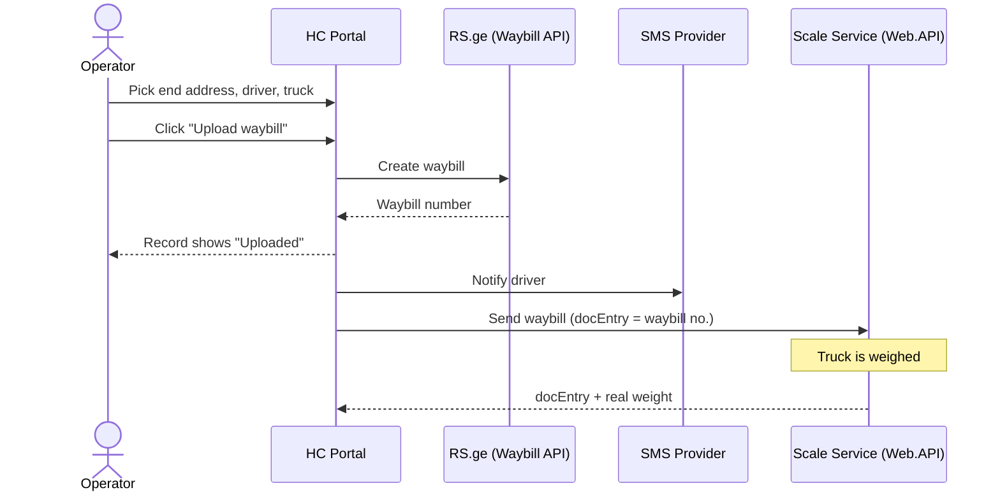
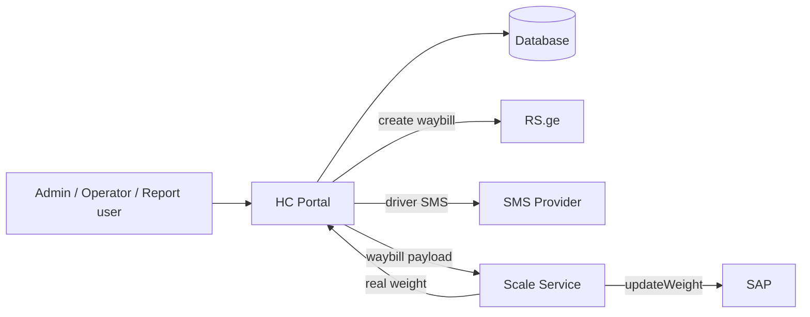

# HC — Carrier & Waybill Portal

A web app where **carrier operators** prepare truck shipments, upload the **waybill to RS.ge**, notify the **driver by SMS**, and pass the waybill to the existing **Scale Service**, which sends back the **real weight** after the truck is weighed.

## How it works



## System overview



## Reference data

| Entity | Fields |
|---|---|
| **Carrier** | Name, code, start address (one), end addresses (one or more, each with its scale ID) |
| **Driver** | First/last name, personal ID, phone |
| **Truck** | Model, plate number, trailer number |
| **User** | Name, phone, email, role |

**Roles:** `Admin` · `Operator` (bound to one carrier) · `Report user`

## Payload sent to the Scale Service

```json
{
  "actionFlag": "s",
  "processType": "s",
  "docEntry": "<waybill number>",
  "docDate": "2026-10-28T17:38:12.493Z",
  "cardCode": "", "cardName": "",
  "u_ShipToCodeS": "", "shipToCode": "",
  "u_DriverName": "",
  "u_TruckNum": "", "u_TruckNum2": "", "u_Truck": "",
  "itemCode": "", "description": "",
  "quantity": 0,
  "whsCode": ""
}
```

Response after weighing: `docEntry` + **actual weight**.

## Existing Scale Service (provided by client)

- .NET Web API (`Web.API.dll`), hosted on IIS, SQL Server DB
- JWT auth via `/auth/token`
- `WeighingProcessController` — start / finish weighing, get truck number
- Pushes final weight to SAP (`updateWeight`)

### Running it locally in Docker

The vendor binaries and database are **not** in this repo. `services/scale/` holds only the container setup and builds the image from the folder the client sent.

```sh
npm run scale up        # first run creates services/scale/.env — set SCALE_VENDOR_DIR + passwords, then run again
npm run scale logs      # follow logs     ·  npm run scale down  # stop
npm run scale reset     # drop the DB volume; the next `up` re-attaches the vendor .mdf
```

| Container | Port (localhost only) | What it is |
| --- | --- | --- |
| `scale-db` | 14330 | SQL Server 2022; attaches `DBi/*.mdf` on first start, creates `scale_api` (owner) and `inspector` (read-only) logins |
| `scale-api` | 5080 | Vendor `Web.API.dll` on `dotnet/aspnet:6.0`; Swagger at `/swagger` in Development |
| `scale-inspector` | 5081 | Small read-only JSON API over the database (`services/scale/inspector`) |

Credentials come from `services/scale/.env` and `services/scale/config/Integration.dll.config` (both git-ignored; examples are committed). The vendor `appsettings.json` and `Integration.dll.config` are stripped from the image.

While the stack is running, admins see **სასწორის ბაზა** in the sidebar (`/#/scale-db`): every table with row counts, paged/sortable/searchable rows, and a detail view per row. Override the URLs with `VITE_SCALE_INSPECTOR_URL` / `VITE_SCALE_API_URL`.

## Running the app

The app is a single React + TypeScript codebase (Vite, Tailwind). It runs in the browser and is wrapped as a native Android app with [Capacitor](https://capacitorjs.com).

> **Everything external is mocked.** RS.ge, the SMS provider and the Scale Service are simulated in `src/api/integrations.ts`, and data is stored in the browser's `localStorage` (`src/mock/`). Nothing leaves the device.

### Dependencies

| For | You need |
|---|---|
| Web | **Node.js 22+** and npm |
| Android APK | Everything above, plus **JDK 21** and the **Android SDK** (platform API 36 + build-tools). Easiest way to get the SDK is installing Android Studio once, or the command-line tools only. The build script finds the SDK in Android Studio's default location and saves it to `android/local.properties`. If you installed it somewhere else, set `ANDROID_HOME`. `java` must be on `PATH` (or `JAVA_HOME` set). Missing SDK platform versions are downloaded automatically on the first build. |

Then install the packages once:

```bash
npm install
```

### Web

```bash
npm run dev          # http://localhost:5173 (also printed with your LAN IP, so you can open it on a phone)
npm run build        # production build → dist/
npm run preview      # serve the production build locally
```

### Android (APK)

```bash
npm run android:apk
```

This builds the web app, copies it into the Android project and builds the APK with Gradle. The file is written to `release/hc-portal-v<version>.apk`. Send it to the user; they open it on the phone and allow "install from unknown sources" when asked.

- **No signing setup is needed.** Gradle signs the APK with the debug key that the Android SDK creates on your machine (`~/.android/debug.keystore`).
- **Updates:** build from the same machine, or copy that `debug.keystore` file to the other machine. An APK signed with a different key won't install over the existing app; the user would have to uninstall first and would lose the app's local data.
- **Version:** comes from `version` in `package.json` (`1.2.3` becomes versionCode `10203`). Bump it for each build you send. Android won't install an update whose versionCode is lower than the installed one.

### Trying the flow

The interface is in Georgian.

1. On the login screen, pick a user. **ოპერატორი** (operator) creates shipments, **ადმინისტრატორი** (admin) also manages reference data, **რეპორტ მომხმარებელი** (report user) is read-only.
2. As an operator, open **ახალი რეისი** (new shipment), pick the end address, driver and truck, then press **ზედნადების ატვირთვა** (upload waybill). The shipment page shows each step live: RS.ge → SMS → Scale → weighed.
3. The mock scale "weighs" the truck after 15 s. You can also press **აწონვის სიმულაცია** (simulate weighing) to enter a weight yourself.
4. In **სატესტო პანელი** (mock console): watch every request and response, change latency, force RS.ge, SMS or Scale failures (to test retries), and reset the demo data.

### Mock assumptions to confirm with the client

- Mapping to the scale payload: `cardCode`/`cardName` = carrier code/name, `u_ShipToCodeS` = end address scale ID, `shipToCode` = end address, `itemCode`/`description`/`whsCode` = cargo item (see `src/api/scalePayload.ts`).
- Cargo items (code, description, warehouse) and the declared quantity are not in the spec. They were added because the scale payload needs them.
- Drivers and trucks are shared across carriers. Only start/end addresses and operators are tied to a carrier.
