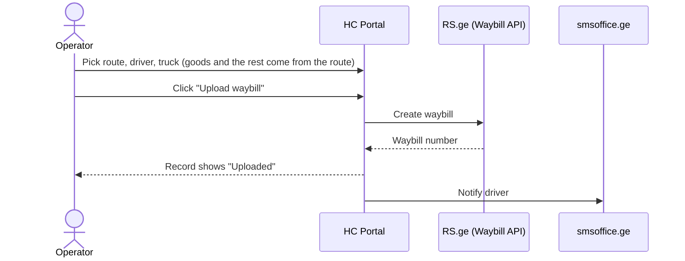
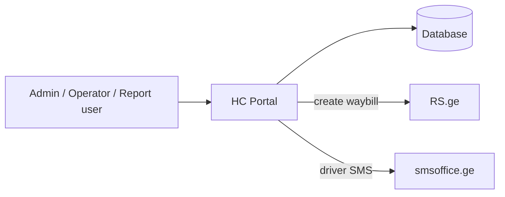

# HC — Carrier & Waybill Portal

A web app where **carrier operators** prepare truck shipments, upload the **waybill to RS.ge** and notify the **driver by SMS**.

## How it works



## System overview



## Reference data

| Entity | Fields |
|---|---|
| **Carrier** | Name, start address (one), end addresses (one or more, each with its scale ID) |
| **Route** | Carrier, end address, scale ID (start → end) and everything its waybills carry, set by the admin: the goods lines and the transport details. Each line's bar code, name and unit are typed in, or filled from the product list with the search button and then still editable (nothing is added to RS.ge's list), with its quantity (plus the optional additional quantity, QUANTITY_EXT), unit price, VAT type and, for excise goods, the excise code (RS.ge's list, loaded on connect); as on RS.ge's own form, picking it sets the line's bar code to the excise goods code and its unit to the code's unit (both locked) and fills the name (editable). Each line becomes one goods line on the RS.ge waybill. Under **დამატებითი ველები**: transport type, transport company, cost and who pays it, supplier/receiver info, comment. A route without goods lines can't be picked until the admin adds them |
| **Driver** | First/last name, personal ID, phone |
| **Truck** | Plate number on RS.ge's car-number list (the one the rs.ge portal suggests); model and trailer number stored here for it. Plates added on the portal show up as trucks; a stored truck whose plate isn't on RS.ge's list can't be picked until the admin adds it there (button on the trucks tab) |
| **Product** | RS.ge's product list itself (name, bar code, unit, excise code), read live and never stored here. Searching a product on a route's goods line fills these in (still editable there); price and VAT type are typed on the line |
| **User** | Name, phone, email, role |

**Roles:** `Admin` · `Operator` (given one or more carriers) · `Report user`

## What is stored, and what is read from RS.ge

The database keeps only what RS.ge doesn't have. Everything RS.ge has is read from it on demand and
held in the server's memory (`server/rscache.ts`), never written to the database:

| Read from RS.ge (memory only) | Stored here |
|---|---|
| Seller (name, tax ID, IDs), units, transport types, excise codes | Service user (password encrypted), waybill defaults |
| Product list | Routes (with their goods lines and prices), carriers |
| Car numbers | Truck model and trailer, drivers, users |
| Each waybill: status, goods, quantities, amounts, buyer, dates, invoice | Shipment: carrier, route, driver, truck, creator, RS.ge waybill ID and number, SMS, history |

A shipment holds what the operator typed only until RS.ge has the waybill; from then on its goods,
quantities and options are RS.ge's (a correction on the rs.ge portal shows up as it is). Pages ask
for the waybills they show; while anyone has the app open, RS.ge is asked every minute which
waybills changed (`RS_CHANGES_SECONDS`) and the ones held are read again, drafts included, so a draft
activated on the portal gets its SMS. The lists are read again every 5 minutes (`RS_LIST_SECONDS`)
and whenever their tab opens. With nobody using the app, RS.ge isn't called. If RS.ge can't be
reached, shipments still list with our side (carrier, route, driver, truck, number, SMS) but without
RS.ge's details.

## Running the app

The app is a React + TypeScript front end (Vite, Tailwind) plus a small Node API server (`server/`, no dependencies). The front end runs in the browser and is wrapped as a native Android app with [Capacitor](https://capacitorjs.com). Browsers and the Android app all talk to the same server, which owns the data, enforces roles and runs the RS.ge → SMS pipeline.

> **RS.ge** (`server/rsge.ts`) and **SMS** (`server/smsoffice.ts`, through [smsoffice.ge](https://smsoffice.ge)) are called for real with the accounts in `.env`. There is no simulator. Data is stored by the server in SQLite at `server/data/hc.db` (Node's built-in `node:sqlite`; override with `HC_DB_FILE`). Delete `hc.db*` to start over with only the admin. On first start an existing `server/data/db.json` (the old storage) is imported and renamed to `db.json.imported`. Back up `hc.db` with `sqlite3 hc.db ".backup copy.db"` (a plain file copy while the server runs can miss the newest changes in `hc.db-wal`).

> **Accounts (`.env`):** the RS.ge service user and the smsoffice.ge account live in `.env` in the project root (copy [`.env.example`](.env.example)): `RS_SERVICE_USER`, `RS_SERVICE_PASSWORD`, `SMSOFFICE_API_KEY`, `SMSOFFICE_SENDER`, plus the optional `RS_WAYBILL_URL` / `SMSOFFICE_URL` and `WAYBILL_AUTO_CLOSE`. They are not stored in `hc.db` and can't be changed in the app: edit `.env` and restart. **The server doesn't start** unless all four are set, RS.ge accepts the service user and smsoffice.ge accepts the key (`getBalance`); it prints what is wrong and exits. Accounts stored in `hc.db` by older versions are removed from it on the first start that passes this check.

> **Sessions** end after 30 days without use or 90 days after login. A user is logged out everywhere when their phone number or role changes, or when they're deleted. **Times** are always shown and grouped by day in Georgian time (UTC+4), whatever the device's time zone.

### Dependencies

| For | You need |
|---|---|
| Web | **Node.js 22+** and npm |
| Android APK | Everything above, plus **JDK 21** and the **Android SDK** (platform API 36 + build-tools). Easiest way to get the SDK is installing Android Studio once, or the command-line tools only. The build script finds the SDK in Android Studio's default location and saves it to `android/local.properties`. If you installed it somewhere else, set `ANDROID_HOME`. `java` must be on `PATH` (or `JAVA_HOME` set). Missing SDK platform versions are downloaded automatically on the first build. |

Then install the packages once:

```bash
npm install
```

### Web

```bash
npm run dev          # http://localhost:5173 (also printed with your LAN IP, so you can open it on a phone)
                     # also starts the API server on port 8787 (restarts on changes); /api is proxied to it
npm run build        # production build → dist/
npm run server       # API server on port 8787 (PORT / HOST to change); also serves dist/ if built
```

### Android (APK)

```bash
npm run android:apk
```

This builds the Android shell with Gradle. The app doesn't carry its own copy of the website: it opens the HC server at the address baked in at build time and shows the site that server serves from `dist/`, so **website updates reach the app on its next start, with no new APK** (`npm run build` on the server is enough). The address is by default this machine's LAN address on port 8787 (e.g. `http://192.168.1.10:8787`). Set `VITE_API_URL` to point it elsewhere, e.g. `VITE_API_URL=https://hc.example.ge npm run android:apk`. The phone must be able to reach that address, and `npm run server` must be running there with the site built. When it can't be reached, the app shows a "no connection" screen that retries every 5 seconds. A new APK is only needed when the address, the app's native parts (Capacitor plugins) or its icon/name change. The file is written to `release/hc-portal-v<version>.apk`. Send it to the user; they open it on the phone and allow "install from unknown sources" when asked.

The latest build is also saved as `release/hc-portal.apk` and copied into `dist/`, so the website serves it at `/hc-portal.apk`. Phones and tablets opening the site in a browser (not the installed app) see a **ჩამოტვირთე აპლიკაცია** (download the app) button on the login screen and in the account menu. The button only appears when that file exists. If your web server doesn't recognise `.apk`, set its content type to `application/vnd.android.package-archive`.

- **No signing setup is needed.** Gradle signs the APK with the debug key that the Android SDK creates on your machine (`~/.android/debug.keystore`).
- **Updates:** build from the same machine, or copy that `debug.keystore` file to the other machine. An APK signed with a different key won't install over the existing app; the user would have to uninstall first and would lose the app's local data.
- **Version:** of the APK shell comes from `version` in `package.json` (`1.2.3` becomes versionCode `10203`). Bump it for each build you send. Android won't install an update whose versionCode is lower than the installed one.

### Trying the flow

The interface is in Georgian.

1. Log in with a phone number. The only built-in user is the admin, **575780323**; there's no SMS code yet, so a known number logs in immediately. There must always be at least one admin: the last one can't be deleted or given another role, but an admin can delete their own account once another admin exists. As admin, add carriers, then open routes for them in **მარშრუტები** (pick the carrier, type the end address and its scale ID, and add the goods lines with their quantities; the start address comes from the carrier), and add drivers, trucks, products and other users (each with their own phone number) in **ცნობარები**. Products need RS.ge to be connected first. An operator is given one or more carriers and sees those carriers' shipments. Roles: **ოპერატორი** (operator) creates shipments, **ადმინისტრატორი** (admin) also manages reference data, **რეპორტ მომხმარებელი** (report user) is read-only.
2. As an operator, open **ახალი რეისი** (new shipment) and pick only the route (routes of all the operator's carriers, each showing its goods), the driver and the truck (picking one suggests the other from the last shipment), then press **ზედნადების ატვირთვა** (upload waybill), or **მხოლოდ შენახვა** to save it on RS.ge without activating. Everything else on the waybill is the route's, and the waybill is always შიდა გადაზიდვა; the summary shows what will be sent. The shipment page shows each step live: RS.ge → SMS, and offers everything the rs.ge portal does for that waybill (see below). **ასლი** starts a new shipment with the same data.
3. In **API მოთხოვნები**: watch every RS.ge and SMS request and response (admins can clear the log).

SMS needs an smsoffice.ge account in `.env` (see below); the server doesn't start without one.

### RS.ge waybills

Protocol: [`docs/rs-ge/waybill_protocol.pdf`](docs/rs-ge/waybill_protocol.pdf) (official, v4.0.4, from eservices.rs.ge → სერვისების დოკუმენტაცია). SOAP endpoint `https://services.rs.ge/WayBillService/WayBillService.asmx` (override with `RS_WAYBILL_URL`).

RS.ge has no separate sandbox host: everything goes to the normal endpoint, and waybills belong to whoever owns the service user. The test users in the protocol (`tbilisi` / `satesto2`) are rejected as of Nov 2026; the public test service user `YVELAM GAMOIYENET:12345678910` / `123456` works (test taxpayer 12345678910, driver `11111111111`). Anyone can see and change its waybills, so cancel each one right after with **გაუქმება**.

Setup:

1. Create a **service user** on eservices.rs.ge (register the server's public IP for it) and put its user name and password in `.env` as `RS_SERVICE_USER` (`name:taxcode`) and `RS_SERVICE_PASSWORD`. The password never reaches browsers.
2. Start the server: it checks the service user on RS.ge, reads the seller and RS.ge's units, and refuses to start if RS.ge rejects it.
3. Set up the routes in **ცნობარები → მარშრუტები**: goods lines (quantity, price, VAT type) and transport details are per route; the RS.ge product list is in **ცნობარები → პროდუქტები**. Every waybill is შიდა გადაზიდვა (internal transport between the company's own sites): the buyer is the seller, taken from the connected service user.

Per shipment the server calls `save_waybill` (type 1, შიდა გადაზიდვა, the buyer being the seller; returns the waybill ID, which is stored so a retry reuses it) and then `send_waybil_vd` (sic; activates it with the transport start set to now, or the planned start, and returns the waybill number. Plain `send_waybill` would keep the time of the save, which is wrong when activation is retried later). On the shipment page, **დასრულება** calls `close_waybill` and **გაუქმება** calls `ref_waybill`; only admins see them (and **წაშლა**). With `WAYBILL_AUTO_CLOSE=H:MM` in `.env` the server completes each active waybill (`close_waybill`) that long after its transport started (RS.ge's start, else the time it was activated), checking every minute; it reads the waybill first and leaves alone one completed or cancelled on the rs.ge portal. Empty or `0:00` turns this off. New shipments are always activated at once (no save-only draft). RS.ge also cancels a completed waybill, so **გაუქმება** stays available after **დასრულება**. After either one the waybill is read back; if RS.ge refused because it was already done on the rs.ge portal, that counts as done. Each of these calls appears in **API მოთხოვნები** with the password masked.

Everything the rs.ge portal's waybill form does is available here (verified against the live service with the test user, Nov 2026):

| Portal | Here | RS.ge call |
|---|---|---|
| ზედნადების ტიპი | Always შიდა გადაზიდვა (1); the buyer is the seller. Older shipments of other types still show and retry as they were made | `save_waybill` TYPE |
| შენახვა / გააქტიურება | **მხოლოდ შენახვა** saves a draft (status **შენახული**); the shipment page then offers **რედაქტირება**, **გააქტიურება** and **წაშლა** (`del_waybill`). A draft activated on the portal is noticed when RS.ge is next asked for changes, and the driver is texted then | `save_waybill`, `send_waybil_vd`, `del_waybill` |
| გადამზიდავი | With transport type გადამზიდავი (7) the waybill carries the company's ს/ნ (`TRANSPORTER_TIN`) but no driver, car or trailer: the company fills those in (sent by the seller, RS.ge refuses with -1053). Instead of being activated it is sent to the company (status **გადამზიდავთან**), which activates it | `save_waybill`, `send_waybill_transporter` |
| გააქტიურების თარიღი | Start of transport now on upload; a saved draft can be activated now or planned, up to 3 days ahead (-1038). A planned start that has passed by a retry becomes now | `send_waybil_vd` begin_date |
| კორექტირება | **კორექტირება** on an active waybill: change route, driver or truck. Keeping the route keeps the waybill's goods; another route brings its own goods and transport details (rows keep their RS.ge ID, removed ones are sent with STATUS -1, new ones with ID 0). Type and start can't change on an active waybill (-1046). A new driver or truck re-sends the SMS. Not after completion (-1027) or once an invoice is attached (-1042) | `save_waybill` with ID and STATUS 1 |
| დასრულება | Delivered now, or at an earlier time (not before the start: -1018, not in the future: -1017) | `close_waybill` / `close_waybill_vd` |
| ანგარიშ-ფაქტურა | Not on შიდა გადაზიდვა (only older waybills of other types); only once transport has started (RS.ge answers -3009 before). After it RS.ge refuses to cancel or correct the waybill | `save_invoice` |
| ამობეჭდვა | **ბეჭდვა**: an A4 waybill from RS.ge's current data, with signature lines | `get_waybill` |
| გაცემული / მიღებული / შენახული, ექსპორტი | **RS.ge ზედნადებები** (admin, report user): every waybill of the taxpayer, made here or anywhere else, for a day / 3 days / week / month, filtered by status and text, exported to CSV. A row opens the waybill with the portal's actions; ours are marked **HC** and link to the shipment | `get_waybills`, `get_buyer_waybills` (72 hours per call, -1064) |
| მივიღე / არ ვეთანხმები | On received waybills in the registry | `confirm_waybill`, `reject_waybill` |
| შტრიხკოდები | **ცნობარები → პროდუქტები** (see below) | `*_bar_code` |

Not offered: the wood category and medicines (service users may only write ordinary waybills: -1076), templates (routes do that job), the car park list for distribution, and Excel import of goods (routes hold the goods).

A retry after a refusal builds the waybill again from the route as it is now (nothing was created on RS.ge), so fixing the route's goods or the settings and pressing **ხელახლა ცდა** is enough. Once a waybill is on RS.ge, changing its route later doesn't rewrite it.

Duplicate protection: every waybill's `COMMENT` ends with the shipment's tag (`HC:<shipment id>`). The time of each `save_waybill` call is recorded before it is sent. If its answer never arrives (timeout, dropped connection, server restart), the next attempt first searches RS.ge (`get_waybills_v1` by last-update time, without a buyer filter; saved drafts are listed too) for a waybill with that tag and continues with it instead of saving a second one. If that search fails, the retry stops with an error instead of risking a duplicate.

Lost activation: RS.ge answers `-1` to `send_waybill` for a waybill that is already active, so when activation fails the server reads the waybill (`get_waybill`). If it is active, its number is taken and the upload counts as done. If the draft was deleted on the rs.ge portal, a new waybill is saved.

Staying in step with RS.ge: a waybill can also be completed, cancelled or corrected on the rs.ge portal, and RS.ge's version is the only one: nothing of it is stored here (see "What is stored" above).
- **Pages ask for what they show.** Lists, the dashboard and reports ask for the waybills they list that aren't held yet (`get_waybill`, three at a time); they arrive with the next state poll. **Opening a shipment** reads its waybill again (at most once every 15 s). Changing a waybill (correction, complete, cancel, invoice) reads it first when none is held.
- **Changes:** while anyone has the app open, `get_waybills_v1` is asked every minute (`RS_CHANGES_SECONDS`) which of the taxpayer's waybills changed (no buyer filter, so a buyer corrected on the portal is still seen), and the held ones (and drafts) are read again. After more than 3 days without asking, what is held is dropped and read again when shown. Settings show when changes were last checked, and **განახლება** checks now.
- A change found this way adds an event to the shipment saying what changed (compared with the copy read before; right after a restart there is nothing to compare with). A draft activated on the portal becomes uploaded here and its driver is texted.
- These read-backs appear in **API მოთხოვნები** with a badge (**სინქრონიზაცია** or **რეისის გახსნა**). The log keeps the last 300 other calls and, separately, the last 100 read-backs, so the frequent reads never push the uploads out.

Products: RS.ge keeps a product list per taxpayer (სასაქონლო კოდები, the bar code base on the rs.ge portal). The products tab shows that list, read live; nothing of it is stored here, and a product's id is its bar code.
- **Adding or editing** a product calls `save_bar_code` (it adds, or overwrites the product with that bar code) and counts as done only if RS.ge really stored it: `save_bar_code` answers 1 even for codes it silently drops (common ones like `67`, `123` or `asd`, apparently because another taxpayer already registered them), so the code is read back with `get_bar_codes` first, and the admin is told to pick another code when it isn't there. **Deleting** calls `delete_bar_code`. The bar code is the product's identity on RS.ge, so **changing it** adds the product under the new code (checked the same way), then deletes the old code and moves the price and VAT type over; routes and waybills keep their own copy of the old code. A change of letter case only is refused.
- **Reading:** `get_bar_codes` reads the whole list every 5 minutes while the app is in use (`RS_LIST_SECONDS`), after connecting, after every change made here, and when the products tab or the new-shipment page opens (at most every 30 s). The tab shows when the list was last read, and **განახლება** reads it now. If a read fails, the last list read stays and the error is shown.
- **Another service user** (another taxpayer) or **disconnecting** forgets everything read from RS.ge at once.
- A route's goods line is a copy of what was picked (and stays as written if the product is deleted on RS.ge), so a waybill takes the line's name, bar code and unit.

Trucks: plates live on the taxpayer's car-number list on RS.ge (`get_car_numbers` / `save_car_numbers` / `delete_car_numbers`); the model and trailer number are stored here. Adding a truck saves its plate there (checked by reading the list back), deleting one removes it (unless another truck has the same plate). A plate added on the portal is a truck here at once, with its record made when a shipment first uses it.

Mapping notes:
- RS.ge has no trailer field: the trailer number is written into `COMMENT`.
- Plate numbers are sent without dashes (`AA-123-BB` → `AA123BB`).
- Quantity is in tonnes; give products a tonne unit, or "other" (99) with the name ტონა (the default for a new product).
- Drivers have a citizenship (Georgian / foreign) → `CHEK_DRIVER_TIN`; foreigners can have a non-11-digit ID.
- `TRANSPORTER_TIN` is sent only when filled in. RS.ge then expects the transport company to activate the waybill, so leave it empty unless that's how you work.

### SMS (smsoffice.ge)

Docs: [smsoffice.ge/integration](https://smsoffice.ge/integration) (in Georgian). Endpoints are under `https://smsoffice.ge` (override with `SMSOFFICE_URL`, e.g. to point at a local mock).

Setup:

1. On smsoffice.ge, open your profile → integration, turn the API on and copy the **API key**. Register a **sender name** (up to 11 Latin letters, digits, `-` or `.`).
2. Put both in `.env` as `SMSOFFICE_API_KEY` and `SMSOFFICE_SENDER` and start the server: it checks the key with `getBalance` and refuses to start if smsoffice.ge rejects it. The key never reaches browsers. The sender can't be checked without sending: a wrong one shows up as an error on the first shipment's SMS.

Per shipment, after RS.ge returns the waybill number, the server sends the driver `ზედნადები №… ატვირთულია. მარშრუტი: … → …. მანქანა: ….` with `POST /api/v2/send/`. The driver's phone (`5XX XX XX XX`) goes out as `9955XXXXXXXX`. All calls are form POSTs with the key in the body, never in the URL. They appear in **API მოთხოვნები** with the key masked.

- **Accepted ≠ delivered.** `ErrorCode 0` only means smsoffice.ge queued the message. Each send carries a random `reference`; about a minute later, and again whenever the shipment is opened (at most every 15 s, for up to 7 days), the server asks `getMessageStatus` and shows **მიწოდებულია**, **ვერ მიწოდდა** or **ვადა გაუვიდა**. A message that wasn't delivered can be sent again from the shipment page.
- **Errors** (wrong key, unknown sender, empty balance, a blocked number…) are shown in Georgian on the shipment with smsoffice.ge's code, and **ხელახლა გაგზავნა** sends again. A message that was already accepted is never sent a second time by a retry.
- **Restarts:** the reference is saved before the send. If the server stops mid-send, on restart it asks smsoffice.ge about that reference first and sends again only if smsoffice.ge doesn't know the message. A timeout with no answer at all is reported as an error; resending then may text the driver twice.
- smsoffice.ge's error code 40 says "text over 160 characters". The waybill SMS is Georgian (Unicode) and usually 100–150 characters, so it's billed as more than one message. If your account refuses long texts with code 40, shorten the text in `sendSms` (`server/logic.ts`).

### Mock assumptions to confirm with the client

- A waybill can carry several products, one goods line each. The admin sets up a route's lines (product, quantity, unit price, VAT type); the operator only picks the route, driver and truck. Every line is sent exactly as written on the route; renaming or removing a product in the list doesn't change routes already filled from it. A shipment's lines are read from the route again until its waybill is on RS.ge, so fixing a price after a refusal applies to the retry; changing a route later doesn't rewrite waybills already on RS.ge.
- Drivers and trucks are shared across carriers. Only the start address, routes and operators are tied to a carrier.
- Deleting a carrier also removes its routes. Records that shipments use are kept, hidden from pickers, so those shipments still show them.
