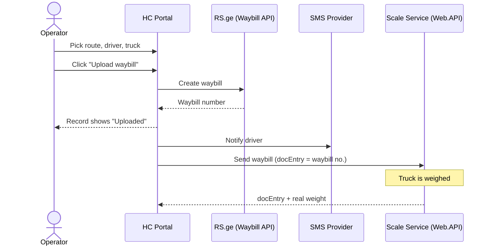
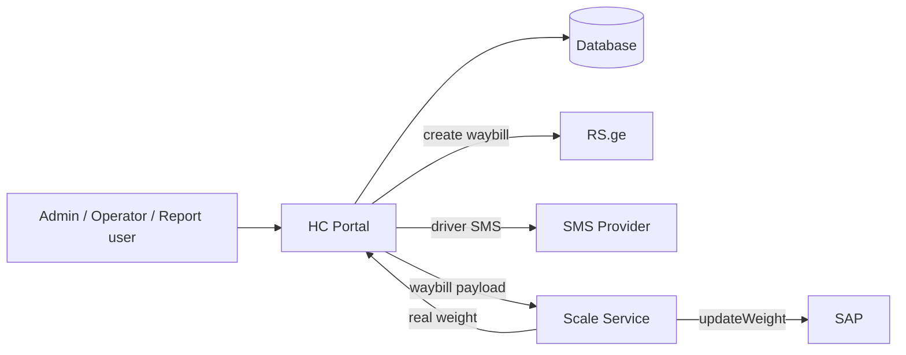

# HC — Carrier & Waybill Portal

A web app where **carrier operators** prepare truck shipments, upload the **waybill to RS.ge**, notify the **driver by SMS**, and pass the waybill to the existing **Scale Service**, which sends back the **real weight** after the truck is weighed.

## How it works



## System overview



## Reference data

| Entity | Fields |
|---|---|
| **Carrier** | Name, address |
| **Route** (linked to carrier) | Name (scale ID), start location, end location |
| **Driver** | First/last name, personal ID, phone |
| **Truck** | Model, plate number, trailer number |
| **User** | Name, phone, email, role |

**Roles:** `Admin` · `Operator` (bound to one carrier) · `Report user`

## Payload sent to the Scale Service

```json
{
  "actionFlag": "s",
  "processType": "s",
  "docEntry": "<waybill number>",
  "docDate": "2026-10-28T17:38:12.493Z",
  "cardCode": "", "cardName": "",
  "u_ShipToCodeS": "", "shipToCode": "",
  "u_DriverName": "",
  "u_TruckNum": "", "u_TruckNum2": "", "u_Truck": "",
  "itemCode": "", "description": "",
  "quantity": 0,
  "whsCode": ""
}
```

Response after weighing: `docEntry` + **actual weight**.

## Existing Scale Service (provided by client)

- .NET Web API (`Web.API.dll`), hosted on IIS, SQL Server DB
- JWT auth via `/auth/token`
- `WeighingProcessController` — start / finish weighing, get truck number
- Pushes final weight to SAP (`updateWeight`)
