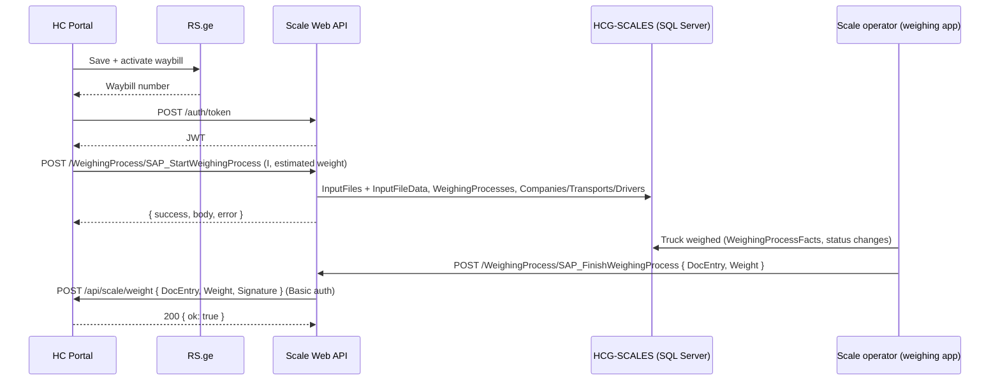

# Scale API (სასწორი)

How the app talks to the weighing service, what each request sends and gets back, and which tables of the
scale's database each one changes.

This was worked out by decompiling the service in `Service/` (`Web.API.dll`, `Core.dll`,
`Infrastructure.dll`, `Integration.dll`: an ASP.NET 6 app, issuer `HBC-WEIGHING-API`, over the SQL
Server database `HCG-SCALES`). Our side is `server/scale.ts` (the client) and the scale section of
`server/logic.ts` (when to send, and the weight callback).

## The flow



Scales are a reference list in the app (**ცნობარები → სასწორი**): each has its **ID** (the factory code
the scale knows, sent as `whsCode`) and the **address of its API**. There can be several, each with its
own address. Every route picks its scale from a dropdown, and a shipment goes to its route's scale.

1. RS.ge gives the waybill its number. The app sends the order to the route's scale with `actionFlag: "I"` and
   the **estimated weight** (the waybill's quantity). The waybill number becomes the scale's order number
   (`DocEntry`).
2. If the waybill is corrected while the truck hasn't been weighed yet, the app sends the order again
   with `"U"`. If the correction moved it to a route with another scale, the old scale gets `"D"` and
   the new one `"I"`. If it's cancelled (from the app or on the rs.ge portal), the scale that has the
   order gets `"D"`.
3. The scale's operator weighs the truck. The weighing app calls `SAP_FinishWeighingProcess`, and the
   API forwards the **real weight** to the address in its `SAP:API:URL:Output` setting. That address
   is now our `POST /api/scale/weight`.
4. The shipment page shows the estimated weight, the real weight and when it was weighed. Each call is
   listed on the API calls page as "სასწორი".

The scale step runs after the driver's SMS. A failure doesn't hold anything else up: the error shows on
the shipment, and **ხელახლა გაგზავნა** sends it again.

## Setup

**In the app:** ცნობარები → სასწორი, add each scale with its ID (e.g. `GE11`, at most 20 characters,
unique) and API address (e.g. `http://kc00001:5000`), then pick it on each route. A scale used by a route
can't be deleted. A scale without an address (the ones made from routes' old typed scale IDs when the
database was upgraded to v31) fails the send with a message saying so, until its address is filled in.

**Our `.env`** (the callback only):

| Variable | Value |
|---|---|
| `SCALE_CALLBACK_USER` | Must equal the scale's `SAP:API:Auth:User` |
| `SCALE_CALLBACK_PASSWORD` | Must equal the scale's `SAP:API:Auth:Pass` |
| `SCALE_CALLBACK_SECRET` | Must equal the scale's `SAP:API:Secret`. Empty means `/api/scale/weight` answers 404. |
| `SCALE_TRUCK_CODE` | Optional. The scale's transport code for our trucks. Default `T00002`, the scale's `SAP:StaticData:CarCode`. |

**On the scale (`Integration.dll.config`)**, point the output at our server:

```xml
<add key="SAP:API:URL:Output" value="https://<our server>/api/scale/weight" />
```

> The copy in `Service/Integration.dll.config` has this line broken (`<add key="SAP:API:URL:Output" http://…/>`,
> with no `value=`). .NET can't read a config file like that, so `SAP_FinishWeighingProcess` fails until
> the line is fixed.

The servers must be able to reach each other. Our server needs to reach every scale's API address (on
Vercel, that means each scale API has to be reachable from the internet). The scale needs to reach our
`/api/scale/weight`.

**Reference data the scale has to have**, or it refuses the order:

| Scale table | Must contain |
|---|---|
| `Factories.Code` | The scale's **ID** from ცნობარები → სასწორი (sent as `whsCode`), e.g. `GE11` |
| `Goods.Code` | Every product bar code used on routes (sent as `itemCode`), e.g. `132744` |
| `Companies` (TypeID 2) | The seller code from the scale's `appsettings.json`, `SAP:StaticData:SellerCompanyCode` (`000010`) |
| `LogisticsTransports.PlateNumber` | **Must not** contain our trucks' plates while they're sent as `T00002` |

## 1. `POST /auth/token`: get a token

| | |
|---|---|
| Auth | None (anonymous) |
| Request | Empty body |
| Response | `200`, `text/plain`: a JWT (HS512, issuer `HBC-WEIGHING-API`, audience `ADM`, signed with `Jwt:Key`) |
| Tables | None |

The token has no expiry, and the API doesn't check lifetimes. The app keeps one per scale address in memory. If the API ever
answers `401`, the app gets a new token once and tries again.

## 2. `POST /WeighingProcess/SAP_StartWeighingProcess`: send an order

`Authorization: Bearer <JWT>`, `Content-Type: application/json`.

### What we send

This example is a real call shape: the client's example, filled from our data.

```json
{
  "actionFlag": "I",
  "processType": "S",
  "docEntry": "276170",
  "docDate": "2026-11-26T00:00:00",
  "cardCode": "204567890",
  "cardName": "შპს …",
  "u_ShipToCodeS": "r_ab12cd",
  "shipToCode": "რუსთავი მშენებელთა 70",
  "u_DriverName": "სანდრო სამხთოშვილი",
  "u_TruckNum": "RL129LR",
  "u_TruckNum2": null,
  "u_Truck": "T00002",
  "itemCode": "132744",
  "description": "CEM II A-L 42.5 R / შ/პალეტით",
  "quantity": 16.0,
  "whsCode": "GE11"
}
```

| Field | Required by the scale | Stored there as (`InputFileData`) | We send |
|---|---|---|---|
| `actionFlag` | yes, 1 char | `Command` | `I` when the waybill gets its number; `U` after a correction; `D` when it's cancelled |
| `processType` | yes, 1 char | `Operation` | `S` (only stored; the client's example uses `S`) |
| `docEntry` | yes | `OrderNumber` (max 20) | Waybill number |
| `docDate` | yes | `Date` | Day the waybill was activated, midnight Tbilisi time, no time zone |
| `cardCode` | yes | `BuyerCompanyCode` (max 20) | The waybill's buyer tax code. On შიდა გადაზიდვა (internal transfer) that's the seller. |
| `cardName` | yes | `BuyerCompanyName` (max 150) | The waybill's buyer name |
| `u_ShipToCodeS` | no | not stored (only in the raw JSON) | Our route ID |
| `shipToCode` | no | not stored (only in the raw JSON) | End address |
| `u_DriverName` | yes | `DriverName` (max 100) | Driver's first and last name |
| `u_TruckNum` | yes | `CarNumber` = `plate` or `plate/trailer` (max 20) | Plate, letters and digits only |
| `u_TruckNum2` | no | joined into `CarNumber` | Trailer number, or `null` |
| `u_Truck` | yes | `CarCode` (max 20) | `SCALE_TRUCK_CODE` (`T00002`) |
| `itemCode` | yes | `ProductCode` (max 20) | Bar code of the first goods line |
| `description` | yes | `ProductName` (max 150) | Name of the first goods line |
| `quantity` | yes | `Weight` decimal(18,4) | **Estimated weight**: the whole waybill's quantity, in tonnes (the scale's unit is `TO`) |
| `whsCode` | yes | `FactoryCode` (max 20) | The ID of the route's scale (ცნობარები → სასწორი) |

The scale also adds `SellerCompanyCode` = `SAP:StaticData:SellerCompanyCode` and `Unit` = `SAP:StaticData:Unit`
(`TO`) from its own settings.

One truck is weighed once, so a shipment is one order. With several goods lines, the first line names
the product and `quantity` is the total.

A shipment isn't sent at all when it has no transport or its route has no scale. The step then shows
as "skipped".

### What comes back

**`200`, order accepted:**

```json
{ "success": true, "body": { …the order as sent… }, "error": "" }
```

**`200`, order refused.** `error` lists every reason, each ending with `;`:

```json
{ "success": false, "body": { … }, "error": "პროდუქცია ვერ მოიძებნა;ქარხნის კოდი ვერ მოიძებნა;" }
```

| Reason | Meaning |
|---|---|
| `ოპერაციის სიმბოლო არასწორია;` | `actionFlag` isn't I, U or D |
| `გამყიდველი კომპანიის კოდი ვერ მოიძებნა;` | The scale's own seller code isn't in `Companies` with TypeID 2 |
| `ქარხნის კოდი ვერ მოიძებნა;` | `whsCode` isn't in `Factories.Code` |
| `პროდუქცია ვერ მოიძებნა;` | `itemCode` isn't in `Goods.Code` |
| `ტრანსპორტის კოდი ეკუთვნის კლიენტს, ხოლო ნომერი ფიქსირდება ლოჯისტიკის ცხრილში;` | Code is `T00002`, but the plate is in `LogisticsTransports` |
| `ტრანსპორტის კოდის და ნომრის კომბინაცია არ იძებნება ლოჯისტიკის ცხრილში;` | Another code, and that code/plate pair isn't in `LogisticsTransports` |

The app shows these on the shipment as `სასწორმა არ მიიღო: …`.

**`400`, a required field is missing or malformed.** ASP.NET answers this itself, before the API's own
code runs:
`{ "title": "One or more validation errors occurred.", "status": 400, "errors": { "DocEntry": ["The DocEntry field is required."] } }`.

**`401`**: no token, or a bad one.

### Tables changed

`I` or `U` for an order number the scale doesn't have yet:

| Step | Table | Change |
|---|---|---|
| Checks | `Companies`, `Factories`, `Goods`, `LogisticsTransports` | Read only |
| Upsert buyer | `Companies` | Insert (`Code` = cardCode, `Name`, `TypeID` 1). If the code already exists, its `Name` is updated. |
| Upsert truck | `Transports` | Insert (`Code` = u_Truck, `PlateNumber`). If the code already exists, its `PlateNumber` is overwritten. Every `T00002` order rewrites that one row's plate. |
| Upsert driver | `Drivers` | Insert, looked up by `FullName` (`IDNumber` and `LicenseNumber` = `-`) |
| The order | `InputFiles` | Insert (`Name` = `SAP:API:<docEntry>`, `ContentRaw` = the JSON as received, `UserID` = the scale's `UserID` setting) |
| | `InputFileData` | Insert: the fields in the table above, plus `HasError` and `DataErrorText` |
| GPS | `WeighingProcessGPSControlPairs` | Insert, only when `LogisticsTransports` has the `u_Truck` code and the GPS Control API accepts the order. This doesn't happen for `T00002`. |
| Start weighing | `WeighingProcesses` | Insert, only when the order has no error. `StatusID` is 1 (ქარხანაში შესვლის მოლოდინში), or 3 when the factory is a quarry (`Factories.IsQuarry`). `Barcode` is a random 8 digits. |
| | `InputFiles` | Update: `WeighingProcessID` is set |
| | `WeighingProcessFacts` | Insert, for a quarry only, when `Transports.FactoryWeight` > 0: the truck's tare (`IsCarWeigh` = 1) |

The buyer, truck and driver upserts run even when the order is refused. A refused order is still stored
(`InputFileData.HasError` = 1, with the reasons in `DataErrorText`), but no weighing starts for it.

`I` or `U` for an order number the scale has, whose weighing hasn't reached status 5 yet:

| Table | Change |
|---|---|
| `Companies`, `Transports`, `Drivers` | Upserts, as above |
| `InputFileData` | Replaced with the new data. `InputFiles.Name` and `ContentRaw` keep the first version. |
| `WeighingProcessGPSControlPairs` | GPS edit, or create when there's no pair yet |
| `WeighingProcesses` | Insert only if the order had none (it was refused before); otherwise unchanged |

If the order's weighing has reached status 5 or later, the scale treats a second `I` or `U` as a new
order: it inserts another `InputFiles` row and starts another weighing. **That's why the app never sends
`U` once the real weight has arrived.**

`D`. No checks or upserts run.

| Table | Change |
|---|---|
| `InputFiles` (and its `InputFileData`) | Deleted |
| `WeighingProcesses` | Deleted, if the order had one |
| (GPS Control API) | Delete, when `LogisticsTransports` has the `u_Truck` code |

A `D` for an order number the scale doesn't have changes nothing and still answers `success: true`.

Weighing statuses (`WeighingProcessStatuses`):

| ID | Status |
|---|---|
| 1 | ქარხანაში შესვლის მოლოდინში |
| 2 | აწონვის დაწყების მოლოდინში |
| 3 | მიმდინარეობს აწონვის პროცესი |
| 4 | მიმდინარეობს დატვირთვა |
| 5 | რეალიზაციის მოლოდინში |
| 6 | რეალიზებული |
| 7 | დასრულებული |

## 3. The real weight: `SAP_FinishWeighingProcess`, then our `/api/scale/weight`

The scale's weighing app (not ours) calls the API when the truck has been weighed:

`POST /WeighingProcess/SAP_FinishWeighingProcess` (Bearer JWT):

```json
{ "DocEntry": "276170", "Weight": 16020 }
```

`Weight` is a whole number (`int`), which means kilograms. The API forwards it to `SAP:API:URL:Output` (our
server) and **changes no tables**:

```http
POST /api/scale/weight
Authorization: Basic base64(SAP:API:Auth:User + ":" + SAP:API:Auth:Pass)
Content-Type: application/json

{ "DocEntry": "276170", "Weight": 16020, "Signature": "<Base64(SHA-256(ASCII(DocEntry + Weight + SAP:API:Secret)))>" }
```

For example, with `DocEntry` 276170, `Weight` 16020 and secret `S`, the signature is
`Base64(SHA-256("27617016020S"))`.

What our server does with it:

| Check | When it fails we answer |
|---|---|
| `SCALE_CALLBACK_SECRET` is set | `404` |
| Basic auth equals `SCALE_CALLBACK_USER:SCALE_CALLBACK_PASSWORD` | `401 { "error": "Unauthorized" }` |
| `DocEntry` and a numeric `Weight` are present | `400` |
| The signature matches | `401 { "error": "Bad signature" }` |
| A shipment has this waybill number | `404 { "error": "No shipment with waybill number …" }` |

When every check passes, we store `scale.weight` (kg) and `scale.weighedAt` on the shipment, add
`სასწორმა დააბრუნა რეალური წონა: 16020 კგ (სავარაუდო 16 ტ)` to its history, and answer
`200 { "ok": true }`. If the truck is weighed again, the new weight replaces the old one, and the
history names both.

The scale's API then answers its weighing app:

- Our `2xx`: `{ "success": true, "body": { …, "Signature": "…" }, "error": "" }`.
- Anything else: `success: false`, with our answer's body as `error`. It also writes that to its log.

**Nothing on RS.ge changes.** The waybill keeps the estimated quantity. The real weight is shown next to
it on the shipment page and in the Excel export (column რეალური წონა (ტ)).

## Other endpoints of the scale API (not used by us)

| Endpoint | What it does | Tables |
|---|---|---|
| `GET /WeighingProcess/GetTruckNumber?admid=&barcode=` | For the silo loading devices (ADM): the plate and silo for a weighing barcode | Reads `WeighingProcesses`, `InputFiles`, `InputFileData`, `Silos` |
| `POST /WeighingProcess/FinishProcess?admid=&barcode=` | Moves a weighing in status 3 or 4, whose ADM matches, to status 3 | Updates `WeighingProcesses.StatusID` |

## Where this lives in our code

| | |
|---|---|
| `server/scale.ts` | The client: token, `SAP_StartWeighingProcess`, logging |
| `server/logic.ts` (section "Scale") | `scaleOrder` (the field mapping), `sendToScale` (I/U/D, which scale, the outcome), `receiveWeight` (the callback); `refs.save`/`remove` for scales |
| `server/config.ts` | `SCALE_CALLBACK_*` and `SCALE_TRUCK_CODE` |
| `src/pages/ReferenceData.tsx` | The სასწორი tab and the route's scale dropdown |
| `src/types.ts` | `Scale` (a scale record) and `ScaleState` (the `scale` field on a shipment) |
| `src/pages/ShipmentDetail.tsx` | The "სასწორზე გაგზავნა" step and the real weight |
